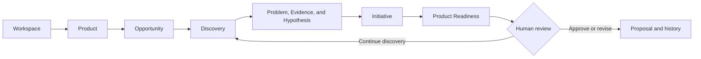
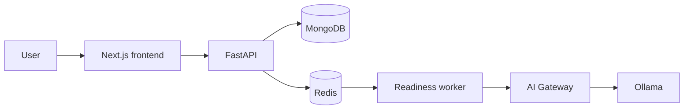

# Fluxium AI Product Management

**Languages:** [English](README.en.md) | [Português](README.md)

A Product Management platform that helps teams turn loosely defined opportunities into problems, evidence, hypotheses, and initiatives that can be evaluated and discussed with context.

> **Status:** MVP/PoC in development. The product specification is still being validated, and some capabilities described in the documentation are not yet connected in the current implementation.

## Overview

Product information is often scattered across conversations, documents, and tools. Fluxium organizes that context into a traceable journey, from an opportunity through initiative readiness assessment, while keeping important decisions under human control.

Planned product journey:



Fluxium is not intended to replace delivery tools. It organizes discovery, makes information gaps visible, and supports Product Management decisions.

## Capabilities

The backend is organized around these domains:

- Workspaces, identity, and authorization;
- Products, Opportunities, and Discovery sessions;
- Business Problems, Evidence, and Hypotheses;
- Initiatives, OKRs, and Business Plans;
- Product Readiness, AI proposals, and audit history.

The specification calls for adaptive Discovery questions, explainable suggestions, and human approval before structured changes. **In the current implementation, Discovery sessions are manual**: the Discovery service persists messages and context but does not call an AI agent. The AI Gateway is used by the asynchronous Product Readiness flow with Ollama. See the [MVP PRD](docs/specifications/AI_Product_Management_Platform_MVP_PRD_v0.1.md) for scope and limitations.

## Architecture



The frontend communicates with the API through `NEXT_PUBLIC_API_BASE_URL`. The backend uses MongoDB for persistence and Redis for asynchronous Readiness assessments. Ollama is the AI provider connected to the worker in this flow.

## Technology Stack

| Area | Technologies |
|---|---|
| Frontend | Next.js 16, React 19, TypeScript, Tailwind CSS |
| Backend | Python 3.13+, FastAPI, Pydantic, Uvicorn |
| Persistence | MongoDB |
| Jobs | Redis and a Python worker |
| AI | AI Gateway and Ollama for Product Readiness |
| Testing | pytest, Playwright |
| Local infrastructure | Docker Compose, Prometheus, Grafana, and Tempo |

## Repository Structure

```text
.
├── backend/
│   ├── app/
│   │   ├── features/       # API domains
│   │   ├── shared/         # authentication, audit, errors, and jobs
│   │   └── workers/        # asynchronous processing
│   ├── scripts/            # index creation
│   └── tests/              # unit and integration tests
├── docker/                 # Compose and observability configuration
├── docs/
│   ├── ai/                 # instructions and SDD process
│   ├── plan/               # analysis and implementation plan
│   ├── specifications/     # PRD, UX, wireframes, and product specification
│   └── standards/          # engineering standards
└── frontend/
    ├── src/app/            # Next.js routes
    ├── src/features/       # domain-oriented features
    └── tests/e2e/          # Playwright scenarios
```

## Local Development Requirements

- Git;
- Docker and Docker Compose;
- Python 3.13 or later;
- [uv](https://docs.astral.sh/uv/);
- Node.js 22 and npm;
- Ollama and a compatible model if you want to run AI-powered Readiness assessments.

### 1. Start MongoDB and Redis

The Compose file declares `fluxium-network` as an external network. Create it once if it does not already exist:

```bash
docker network create fluxium-network
```

If Docker reports that the network already exists, continue. Start the services required by the API:

```bash
docker compose -f docker/docker-compose.infra.yml up -d mongo redis
```

### 2. Configure and run the backend

```bash
cd backend
cp .env.example .env
```

Edit `backend/.env` and set `FLUXIUM_IDENTITY_JWT_SECRET` to a random secret of at least 32 bytes. Do not use real credentials in a shared local environment or commit this file.

Install dependencies and start the API:

```bash
uv sync --dev
uv run uvicorn app.main:app --reload
```

By default, the API is available at `http://localhost:8000`. Interactive API documentation is at [`/docs`](http://localhost:8000/docs), the OpenAPI schema is at [`/openapi.json`](http://localhost:8000/openapi.json), and the health check is at [`/api/v1/health`](http://localhost:8000/api/v1/health).

### 3. Configure and run the frontend

In another terminal:

```bash
cd frontend
npm ci
NEXT_PUBLIC_API_BASE_URL=http://localhost:8000/api/v1 npm run dev
```

Open `http://localhost:3000`.

### 4. (Optional) Enable AI-powered Readiness assessments

The Readiness worker uses Ollama. The Ollama service in Compose is configured with the NVIDIA runtime, which requires a Docker installation compatible with NVIDIA. Alternatively, configure an Ollama instance reachable through `FLUXIUM_OLLAMA_BASE_URL`.

To use the Ollama service defined in Compose:

```bash
docker compose -f docker/docker-compose.infra.yml up -d ollama
docker exec -it ollama-1 ollama pull qwen3:4b-instruct
```

Set `FLUXIUM_OLLAMA_BASE_URL` and `FLUXIUM_OLLAMA_MODEL=qwen3:4b-instruct` in `backend/.env`. In another terminal, from the `backend/` directory, start the worker:

```bash
uv run python -m app.workers.readiness_worker
```

Discovery sessions do not use this worker or generate AI-powered questions in the current implementation.

## Tests and Checks

### Backend

```bash
cd backend
uv run pytest
```

MongoDB and Redis integration tests are opt-in. See `backend/.env.example` for the `FLUXIUM_RUN_MONGO_INTEGRATION` and `FLUXIUM_RUN_REDIS_INTEGRATION` variables, and run those tests only when the corresponding services are configured.

### Frontend

```bash
cd frontend
npm run lint
npm run build
npm run test:e2e
```

The Playwright E2E tests start the development server on port `3100`. On the first run, install the Playwright browser with `npx playwright install chromium`.

## Configuration

Backend variables use the `FLUXIUM_` prefix and are documented in [`backend/.env.example`](backend/.env.example). Key variables include:

| Variable | Purpose |
|---|---|
| `FLUXIUM_MONGO_URI` | MongoDB URI; the local default uses the `rs0` replica set |
| `FLUXIUM_MONGO_DATABASE` | Application MongoDB database |
| `FLUXIUM_REDIS_URL` | Redis connection for jobs |
| `FLUXIUM_OLLAMA_BASE_URL` | Ollama provider URL |
| `FLUXIUM_OLLAMA_MODEL` | Model configured for Ollama |
| `FLUXIUM_IDENTITY_JWT_SECRET` | Secret for the internal HS256 identity provider |
| `FLUXIUM_DEFAULT_WORKSPACE_ID` | Default workspace when the token does not include `workspace_ids` |

On the frontend, `NEXT_PUBLIC_API_BASE_URL` sets the API base URL. Since it is a `NEXT_PUBLIC_` variable, its value is included in the client bundle.

## Product and Engineering Documentation

- [Project instructions](docs/ai/00-instructions.md)
- [Specification Driven Development process](docs/ai/specification-driven-development.md)
- [Product specification](docs/specifications/AI_Product_Management_Platform_Especificacao_v0.1.md)
- [MVP PRD](docs/specifications/AI_Product_Management_Platform_MVP_PRD_v0.1.md)
- [MVP UX](docs/specifications/AI_Product_Management_Platform_MVP_UX_v0.1.md)
- [MVP wireframes](docs/specifications/AI_Product_Management_Platform_MVP_Wireframes_v0.1.md)
- [Traceability](docs/traceability.md)
- [Frontend standards](docs/standards/08-frontend-nextjs-typescript.md)
- [Testing standards](docs/standards/05-testing.md)

New features should follow the specification, analysis, planning, validation, implementation, testing, and traceability workflow defined by the SDD process.

## Security

- Never commit `.env` files, keys, tokens, or credentials.
- Do not expose provider secrets in the frontend; `NEXT_PUBLIC_` variables are public.
- Use environment-appropriate secrets. The Compose values are intended for local development only.
- Data access must preserve tenant and workspace isolation.

## Status and License

This repository is under active development. Product specifications describe the proposed scope and may include functionality that has not yet been implemented.

This project is distributed under the **GNU Affero General Public License v3.0 (AGPL-3.0-only)**. See [`LICENSE`](LICENSE) for the full text. The AGPL includes obligations to make corresponding source code available in certain forms of distribution and remote interaction with modified versions.

To propose improvements to the upstream repository, open an issue and submit a pull request following the [contribution guide](CONTRIBUTING.md). The license does not require users of forks to send changes back to this repository.