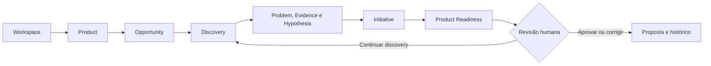
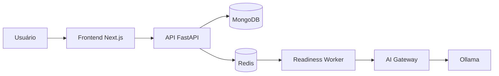

# Fluxium AI Product Management

**Idiomas:** [Português](README.md) | [English](README.en.md)

Plataforma de Product Management que ajuda equipes a transformar oportunidades pouco estruturadas em problemas, evidências, hipóteses e iniciativas que possam ser avaliadas e discutidas com contexto.

> **Status:** MVP/PoC em desenvolvimento. A especificação do produto ainda está em validação e algumas capacidades descritas nos documentos não estão conectadas na implementação atual.

## Visão geral

Informações de produto costumam ficar espalhadas por conversas, documentos e ferramentas. O Fluxium organiza esse contexto em uma jornada rastreável, da oportunidade à avaliação de prontidão da iniciativa, mantendo decisões importantes sob controle humano.

Jornada de produto prevista:



O objetivo não é substituir ferramentas de delivery. O produto organiza a descoberta, torna lacunas visíveis e apoia decisões de Product Management.

## Capacidades

O backend está organizado em domínios para:

- Workspaces, identidade e autorização;
- Products, Opportunities e sessões de Discovery;
- Business Problems, Evidence e Hypotheses;
- Initiatives, OKRs e Business Plans;
- Product Readiness, propostas de IA e auditoria.

A especificação prevê perguntas adaptativas durante o Discovery, sugestões explicáveis e aprovação humana antes de alterações estruturadas. **Na implementação atual, as sessões de Discovery são manuais**; o serviço de Discovery persiste mensagens e contexto, mas não chama um agente de IA. O AI Gateway é usado pelo fluxo assíncrono de Product Readiness com Ollama. Consulte o [PRD](docs/specifications/AI_Product_Management_Platform_MVP_PRD_v0.1.md) para escopo e limitações detalhados.

## Arquitetura



O frontend conversa com a API pela variável `NEXT_PUBLIC_API_BASE_URL`. O backend usa MongoDB para persistência e Redis para execução assíncrona de avaliações de Readiness. O Ollama é o provider de IA conectado ao worker nesse fluxo.

## Stack

| Área | Tecnologias |
|---|---|
| Frontend | Next.js 16, React 19, TypeScript, Tailwind CSS |
| Backend | Python 3.13+, FastAPI, Pydantic, Uvicorn |
| Persistência | MongoDB |
| Jobs | Redis e worker Python |
| IA | AI Gateway e Ollama para Product Readiness |
| Testes | pytest, Playwright |
| Infra local | Docker Compose, Prometheus, Grafana e Tempo |

## Estrutura do repositório

```text
.
├── backend/
│   ├── app/
│   │   ├── features/       # domínios da API
│   │   ├── shared/         # autenticação, auditoria, erros e jobs
│   │   └── workers/        # processamento assíncrono
│   ├── scripts/            # criação de índices
│   └── tests/              # testes unitários e de integração
├── docker/                 # Compose e configuração de observabilidade
├── docs/
│   ├── ai/                 # instruções e processo SDD
│   ├── plan/               # análise e plano de implementação
│   ├── specifications/     # PRD, UX, wireframes e especificação
│   └── standards/          # padrões de engenharia
└── frontend/
    ├── src/app/            # rotas Next.js
    ├── src/features/       # funcionalidades por domínio
    └── tests/e2e/          # cenários Playwright
```

## Requisitos para desenvolvimento local

- Git;
- Docker e Docker Compose;
- Python 3.13 ou superior;
- [uv](https://docs.astral.sh/uv/);
- Node.js 22 e npm;
- Ollama e um modelo compatível caso queira executar avaliações de Readiness com IA.

### 1. Inicie MongoDB e Redis

O Compose declara a rede `fluxium-network` como externa. Crie-a uma vez se ainda não existir:

```bash
docker network create fluxium-network
```

Se o Docker informar que a rede já existe, prossiga. Suba os serviços necessários para executar a API:

```bash
docker compose -f docker/docker-compose.infra.yml up -d mongo redis
```

### 2. Configure e execute o backend

```bash
cd backend
cp .env.example .env
```

Edite `backend/.env` e defina `FLUXIUM_IDENTITY_JWT_SECRET` com um segredo aleatório de pelo menos 32 bytes. Não use credenciais reais em ambiente local compartilhado e não versione esse arquivo.

Instale as dependências e inicie a API:

```bash
uv sync --dev
uv run uvicorn app.main:app --reload
```

Por padrão, a API fica em `http://localhost:8000`. A documentação interativa está em [`/docs`](http://localhost:8000/docs), o schema OpenAPI em [`/openapi.json`](http://localhost:8000/openapi.json) e o health check em [`/api/v1/health`](http://localhost:8000/api/v1/health).

### 3. Configure e execute o frontend

Em outro terminal:

```bash
cd frontend
npm ci
NEXT_PUBLIC_API_BASE_URL=http://localhost:8000/api/v1 npm run dev
```

Abra `http://localhost:3000`.

### 4. (Opcional) Habilite avaliações de Readiness com IA

O worker de Readiness usa Ollama. O serviço Ollama do Compose está configurado com runtime NVIDIA; essa opção requer uma instalação Docker compatível com NVIDIA. Como alternativa, configure um Ollama acessível em `FLUXIUM_OLLAMA_BASE_URL`.

Para usar o serviço Ollama definido no Compose:

```bash
docker compose -f docker/docker-compose.infra.yml up -d ollama
docker exec -it ollama-1 ollama pull qwen3:4b-instruct
```

Configure `FLUXIUM_OLLAMA_BASE_URL` e `FLUXIUM_OLLAMA_MODEL=qwen3:4b-instruct` em `backend/.env`. Em outro terminal, no diretório `backend/`, inicie o worker:

```bash
uv run python -m app.workers.readiness_worker
```

As sessões de Discovery não usam esse worker nem geram perguntas com IA na implementação atual.

## Testes e verificações

### Backend

```bash
cd backend
uv run pytest
```

Os testes de integração com MongoDB e Redis são opt-in. Consulte `backend/.env.example` para as variáveis `FLUXIUM_RUN_MONGO_INTEGRATION` e `FLUXIUM_RUN_REDIS_INTEGRATION` e execute-os somente com os serviços correspondentes configurados.

### Frontend

```bash
cd frontend
npm run lint
npm run build
npm run test:e2e
```

Os testes E2E usam Playwright e iniciam o servidor de desenvolvimento na porta `3100`. Na primeira execução, instale o navegador do Playwright com `npx playwright install chromium`.

## Configuração

As variáveis do backend usam o prefixo `FLUXIUM_` e estão documentadas em [`backend/.env.example`](backend/.env.example). Entre as principais:

| Variável | Finalidade |
|---|---|
| `FLUXIUM_MONGO_URI` | URI do MongoDB; o padrão local usa o replica set `rs0` |
| `FLUXIUM_MONGO_DATABASE` | Banco MongoDB da aplicação |
| `FLUXIUM_REDIS_URL` | Conexão Redis para jobs |
| `FLUXIUM_OLLAMA_BASE_URL` | Endereço do provider Ollama |
| `FLUXIUM_OLLAMA_MODEL` | Modelo configurado para o Ollama |
| `FLUXIUM_IDENTITY_JWT_SECRET` | Segredo do provider interno de identidade HS256 |
| `FLUXIUM_DEFAULT_WORKSPACE_ID` | Workspace padrão quando o token não contém `workspace_ids` |

No frontend, `NEXT_PUBLIC_API_BASE_URL` define o endereço-base da API. Como é uma variável `NEXT_PUBLIC_`, seu valor é incorporado ao bundle do cliente.

## Documentação do produto e engenharia

- [Instruções do projeto](docs/ai/00-instructions.md)
- [Processo Specification Driven Development](docs/ai/specification-driven-development.md)
- [Especificação do produto](docs/specifications/AI_Product_Management_Platform_Especificacao_v0.1.txt)
- [PRD do MVP](docs/specifications/AI_Product_Management_Platform_MVP_PRD_v0.1.md)
- [UX do MVP](docs/specifications/AI_Product_Management_Platform_MVP_UX_v0.1.md)
- [Wireframes do MVP](docs/specifications/AI_Product_Management_Platform_MVP_Wireframes_v0.1.md)
- [Rastreabilidade](docs/traceability.md)
- [Padrões de frontend](docs/standards/08-frontend-nextjs-typescript.md)
- [Padrões de testes](docs/standards/05-testing.md)

Novas funcionalidades devem seguir o fluxo de especificação, análise, planejamento, validação, implementação, testes e rastreabilidade definido no processo SDD.

## Segurança

- Nunca versione arquivos `.env`, chaves, tokens ou credenciais.
- Não exponha segredos de providers no frontend; variáveis `NEXT_PUBLIC_` são públicas.
- Use segredos próprios e apropriados ao ambiente. Os valores do Compose são destinados apenas ao desenvolvimento local.
- Dados e acesso devem respeitar o isolamento por tenant e workspace.

## Status e licença

Este repositório está em evolução; os documentos de especificação são a referência do escopo proposto e podem incluir funcionalidades ainda não implementadas.

Não há um arquivo `LICENSE` na raiz neste momento. A publicação pública no GitHub, por si só, não define uma licença de uso ou redistribuição.