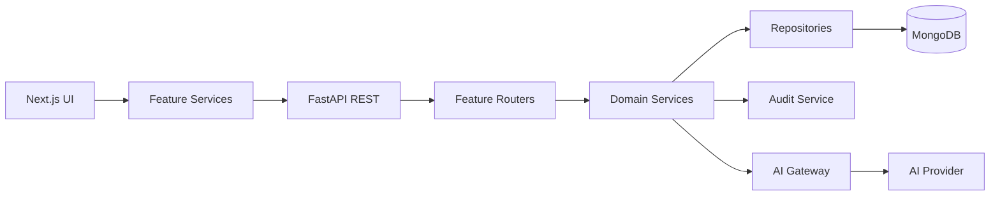

# Plano de Implementacao - Fluxium AI Product Management MVP

**Versao:** 0.1  
**Data:** 2026-09-18  
**Status:** Proposta para validacao  
**Analise de origem:** `docs/plan/analysis.md`  
**PRD:** `docs/specifications/AI_Product_Management_Platform_MVP_PRD_v0.1.md`  
**UX:** `docs/specifications/AI_Product_Management_Platform_MVP_UX_v0.1.md`  
**Wireframes:** `docs/specifications/AI_Product_Management_Platform_MVP_Wireframes_v0.1.md`

## 1. Objetivo

Definir a arquitetura, os contratos, os componentes, a persistencia e a
estrategia de testes para implementar o MVP do Fluxium sem antecipar Delivery,
Release, Outcome, Product Graph ou integrações externas de execução.

O plano cobre o fluxo:

```text
Workspace -> Product -> OKR -> Opportunity -> Discovery
    -> Business Problem + Evidence + Hypothesis
        -> Initiative -> Business Plan 5W2H opcional
            -> Product Readiness -> Aprovacao humana
```

## 1.1 Incremento REQ-MVP-011 - Gestao de OKRs

### Decisoes tecnicas

- Manter `Objective` como agregado independente com `KeyResult` embutido, pois
  os KRs possuem ciclo de vida e leitura normalmente associados ao Objective.
- Exigir `product_id` na criacao do Objective e validar o Product no Service por
  repository tenant-scoped contra os claims autenticados.
- Manter `objective_ids` na Initiative. O Service de Initiative valida cada
  Objective no mesmo workspace e Product da Opportunity, permitindo que um
  Objective seja reutilizado por varias Initiatives.
- Preservar identificador e timestamps dos KRs quando uma atualizacao parcial
  substituir a lista de KRs.
- Expor a gestao manual no workspace com listagem por workspace e formulario
  modal para Objective e seus KRs.
- Nao implementar ciclo de OKR, check-in, progresso historico ou dashboard,
  pois nao fazem parte do REQ-MVP-011.

### Contratos e componentes do incremento

Backend:

- `ObjectiveService` recebera repositories de Product e Initiative para
  validar referencias e derivar a associacao coerente.
- `CreateObjectiveRequest` exigira pelo menos uma referencia de contexto.
- O dominio continuara validando Objective qualitativo e KRs quantitativos,
  com limites explicitos para listas e textos.
- A collection `objectives` mantera indice tenant/workspace e os endpoints
  REST existentes.

Frontend:

- `features/okrs/services/okr-service.ts` encapsulara listagem, criacao e
  atualizacao da API.
- `features/okrs/components/okr-management.tsx` exibira Objectives e KRs,
  com selecao obrigatoria de Product e modal de cadastro/edicao.
- `features/workspace/components/workspace-context.tsx` permitira selecionar
  varios Objectives ao criar uma Initiative.
- `app/workspace/okrs/page.tsx` sera o entrypoint da rota.
- A navegacao e as mensagens de i18n serao atualizadas sem mover regras de
  negocio para `app/*`.

### Estrategia de testes

- testes de Service com repositories fake para Product autorizado, Objective
  ausente, workspace negado, Product inconsistente e varios Objectives;
- testes de dominio/schema para campos quantitativos e limites;
- teste de persistencia para serializacao Decimal128 e filtro tenant/workspace;
- lint e build do frontend após a nova tela.

## 2. Premissas e decisões de planejamento

### 2.1 Premissas confirmadas

- Python 3.13+, FastAPI, Pydantic 2+ e MongoDB no backend.
- Next.js App Router, React e TypeScript no frontend.
- Server Components por padrão; Client Components somente para interação.
- Repositories são o único acesso ao MongoDB.
- IA é acessada exclusivamente pelo AI Gateway.
- Sugestões de IA nunca mutam o Product Model sem aprovação humana.
- Apenas `ADMIN` e `PRODUCT_MANAGER` aprovam propostas da IA.
- Um Product pode ter vários Objectives.
- Cada Objective pode possuir vários Key Results.
- 5W2H é opcional no Business Plan.
- O Business Plan é uma visão estruturada da Initiative, não um módulo de
  delivery ou orçamento completo.

### 2.2 Assunções provisórias para o plano

Estas escolhas permitem detalhar a implementação e devem ser confirmadas antes
 do desenvolvimento dos contratos finais:

1. OKR será modelado como recurso de contexto do Product, com associação
  opcional a Initiative. O MVP começará sem ciclos formais de OKR.
2. `How Much` será armazenado como valor estruturado com tipo de recurso, valor
  opcional, moeda/unidade opcional e observação, aceitando custo, esforço ou
  recurso.
3. A primeira versão usará versionamento otimista por `version` em agregados e
   collections próprias para audit events e assessments.
4. O fluxo `Salvar e iniciar Discovery` criará a Opportunity em `NEW` e fará a
  transição para `DISCOVERY` na mesma operação de domínio.
5. Readiness será um job assíncrono quando envolver IA; avaliações manuais ou
   de baixa latência poderão retornar de forma síncrona se o contrato final
   permitir.

6. A autenticação será integrada ao mecanismo desenvolvido na plataforma de
  plataforma de identidade por meio de uma porta, sem acoplar o domínio ao
  formato interno do provedor.
7. Ollama local será o provider inicial de testes, acessado exclusivamente pelo
  AI Gateway.
8. Redis será usado inicialmente para jobs assíncronos; a porta de mensageria
  deverá permitir substituição futura por RabbitMQ.
9. Mensagens de Discovery, contexto, assessments e auditoria terão retenção de
  cinco anos.
10. O ambiente inicial será local e os dados atuais do MVP não são classificados
   como sensíveis.

11. A confiança de Readiness será calculada no domínio após a resposta do
  provider. O cálculo combinará confiança declarada, completude dos três
  blocos de contexto e cobertura das oito dimensões, com penalidades
  determinísticas para lacunas e perguntas abertas. Score e confiança serão
  persistidos separadamente; calibração com Outcomes não pertence ao MVP.

12. A tela de Readiness oferecerá oito campos orientadores de contexto
  (`problem`, `audience`, `value`, `evidence`, `solution`, `feasibility`,
  `alignment` e `measurement`) e preservará a nota livre opcional. As
  respostas serão encaminhadas no contexto do job, sem persistência de um
  novo agregado e sem inferir conteúdo para campos vazios.

Nenhuma dessas assunções deve ocultar a necessidade de decisão; elas devem ser
registradas no plano de execução e nos contratos quando aprovadas.

## 3. Arquitetura proposta

### 3.1 Backend

```text
backend/
├── app/
│   ├── main.py
│   ├── config/
│   ├── http/
│   ├── shared/
│   │   ├── auth/
│   │   ├── errors/
│   │   ├── observability/
│   │   ├── pagination/
│   │   └── tenancy/
│   ├── integrations/
│   │   ├── ai_gateway/
│   │   └── observability/
│   └── features/
│       ├── workspaces/
│       ├── products/
│       ├── okrs/
│       ├── opportunities/
│       ├── discovery/
│       ├── business_problems/
│       ├── evidence/
│       ├── hypotheses/
│       ├── initiatives/
│       ├── business_plans/
│       ├── readiness/
│       ├── proposals/
│       └── audit/
├── migrations/
└── tests/
```

Cada feature deve manter fronteiras semelhantes:

```text
features/<feature>/
├── domain/
│   ├── entities.py
│   ├── enums.py
│   ├── value_objects.py
│   └── policies.py
├── schemas/
│   ├── requests.py
│   └── responses.py
├── repository.py
├── service.py
├── router.py
├── mapper.py
└── dependencies.py
```

Regras:

- Router apenas extrai contexto, valida schema, chama Service e mapeia resposta.
- Service coordena casos de uso, autorização de domínio e transações curtas.
- Domain contém invariantes, enums, value objects e transições.
- Repository encapsula filtros tenant-scoped, projeções, índices e concorrência.
- Integrações externas ficam em `integrations/` e não entram diretamente no
  domínio.

### 3.2 Frontend

```text
frontend/
├── src/
│   ├── app/
│   │   ├── (workspace)/
│   │   ├── products/
│   │   ├── opportunities/
│   │   └── initiatives/
│   ├── features/
│   │   ├── workspace/
│   │   ├── products/
│   │   ├── okrs/
│   │   ├── opportunities/
│   │   ├── discovery/
│   │   ├── initiatives/
│   │   ├── business-plans/
│   │   ├── readiness/
│   │   └── audit/
│   ├── components/
│   ├── services/
│   ├── lib/
│   ├── hooks/
│   └── types/
└── tests/
```

Cada feature frontend deve possuir `entry/`, `components/`, `services/`,
`types/`, `validations/` e `public-api.ts` quando houver consumo externo.

- `app/*` compõe rotas e layouts, sem regra de negócio.
- Server Components fazem leituras por Services.
- Client Components controlam formulários, conversa, drawers, modais e ações.
- O cliente HTTP e o adapter RFC 7807 ficam centralizados.
- Estado deve seguir a ordem Server State, URL State, Component State e Global
  State.

### 3.3 Fluxo de dependências



## 4. Componentes e responsabilidades

### 4.1 Workspace e autorização

**Componentes:** `WorkspaceContext`, `AuthorizationService`,
`TenantScope`, `PermissionPolicy`.

Implementação inicial: `backend/app/shared/auth` funciona como provider interno de identidade.
O backend valida JWT assinado, normaliza `sub`, `tenant_id`, workspaces e
papéis para `IdentityClaims`, e expõe dependências FastAPI para autenticação, RBAC e
escopo de workspace. O backend não implementa login nem sessão de portal.

Responsabilidades:

- derivar `tenant_id` e `workspace_id` do contexto autenticado;
- validar acesso ao Product e às entidades relacionadas;
- impedir acesso cruzado entre workspaces;
- aplicar permissões por recurso e transição;
- definir `can_approve_ai_proposal` apenas para `ADMIN` e
  `PRODUCT_MANAGER`.
- rejeitar tokens sem `sub`, `exp`, `tenant_id` ou assinatura válida;
- derivar tenant e workspace exclusivamente dos claims autenticados;
- retornar `401` para identidade inválida e `403` para papel ou workspace sem
  autorização.

### 4.2 Product

**Entidade:** `Product`.

Responsabilidades:

- nome, descrição, visão, status e timestamps;
- associação com Opportunities, Initiatives e OKRs;
- criação e atualização com versão otimista.

### 4.3 OKR

**Entidades:** `Objective` e `KeyResult`.

Responsabilidades:

- permitir múltiplos Objectives por Product/Workspace;
- permitir múltiplos KRs por Objective;
- validar Objective qualitativo;
- validar KR com métrica, alvo e prazo;
- associar OKR à Initiative sem duplicar o Objective;
- preservar histórico de alterações.

### 4.4 Opportunity e Discovery

**Entidades:** `Opportunity`, `DiscoverySession`, `DiscoveryMessage`.

Responsabilidades:

- manter entrada original do usuário;
- controlar transições de Opportunity;
- persistir perguntas, respostas e mensagens;
- manter contexto estruturado e perguntas abertas;
- permitir execução manual quando a IA falhar;
- evitar arrays sem crescimento controlado em MongoDB.

### 4.5 Business Problem, Evidence e Hypothesis

**Entidades:** `BusinessProblem`, `Evidence`, `Hypothesis`.

Responsabilidades:

- registrar relações entre problema, evidência, hipótese e Initiative;
- distinguir origem manual, importada e observada;
- representar confiança como estimativa;
- validar status e pré-condições de relacionamento.

### 4.6 Initiative e Business Plan

**Entidades:** `Initiative`, `BusinessPlan` ou subdocumento versionado,
conforme decisão de agregação.

Recomendação inicial: manter o Business Plan como parte versionada do agregado
Initiative, porque seu ciclo de vida é o da decisão da Initiative e o 5W2H é
opcional. Se o histórico ou leitura crescerem significativamente, extrair para
collection própria sem alterar o contrato HTTP.

Responsabilidades:

- consolidar contexto de Opportunity, Business Problem, Evidence e Hypothesis;
- armazenar objetivo, resultado, escopo, KPI, riscos e dependências;
- associar Objectives e Key Results;
- armazenar 5W2H opcional;
- controlar status e versão;
- impedir transições sem autorização ou Readiness exigido.

### 4.7 Product Readiness

**Entidades:** `ReadinessAssessment`, `ReadinessDimension`.

Responsabilidades:

- calcular score geral e dimensões;
- registrar justificativas, lacunas, perguntas e confiança;
- armazenar versão exata do contexto;
- registrar provider, modelo, prompt e timestamp;
- manter assessments imutáveis;
- marcar assessment como desatualizado quando a Initiative mudar.

### 4.8 AI Gateway e propostas

**Componentes:** `AiGateway`, `AiProvider`, `AiProposalService`,
`ProposalApprovalService`.

Responsabilidades:

- desacoplar domínio de provider;
- padronizar timeout, retry e erro;
- validar resposta mínima da IA;
- gerar propostas estruturadas sem persistir mutação de domínio;
- calcular diff dos campos afetados;
- aceitar ou rejeitar propostas apenas conforme autorização;
- registrar decisão e audit event.

### 4.9 Operação e teste do worker Redis de Readiness

O contrato operacional permanece restrito às portas existentes:

```text
submit -> RedisJobStore(PENDING) -> readiness_worker.run_once()
  -> RedisJobStore.claim_pending -> ReadinessAssessmentJobService.run_claimed
       -> RUNNING -> SUCCEEDED | FAILED
```

`RedisJobStore` mantém o registro do job, a chave de idempotência e o lease de
claim. O worker é responsável por descobrir e reivindicar o job; o serviço de
Readiness executa a transição e associa o assessment
quando a geração for válida. Falhas do AI Gateway resultam em `FAILED` sem
criar assessment; retry reutiliza o mesmo `job_id` e incrementa
`retry_count`. Este documento não propõe alterar o worker principal, criar um
daemon adicional ou registrar um novo router.

#### Estratégia de integração

- **Infraestrutura:** Redis real no endereço de `FLUXIUM_REDIS_URL`; o teste é
  opt-in via `FLUXIUM_RUN_REDIS_INTEGRATION=1` e é pulado de forma explícita
  quando a flag não está habilitada ou Redis não responde.
- **Provider de IA:** `FakeAIProvider` injetável, com uma resposta de readiness
  válida para `SUCCEEDED` e uma exceção controlada para `FAILED`; nenhum teste
  chama Ollama.
- **Sincronização:** `run_once()` reivindica o job com lease e o teste consulta
  o status até um estado terminal, com timeout configurável por
  `FLUXIUM_REDIS_INTEGRATION_TIMEOUT_SECONDS`; não usa `sleep` fixo para
  assumir duração do worker.
- **Isolamento:** cada fixture usa prefixo Redis aleatório e remove suas chaves
  no teardown. O repositório de assessment é fake porque o objetivo deste
  cenário é a fronteira Redis/worker, não a persistência Mongo.
- **Aceite:** o fluxo de sucesso termina em `SUCCEEDED` com assessment; o
  fluxo de erro termina em `FAILED`, preserva a mensagem do provider e não
  cria assessment.

## 5. Entidades e contratos de domínio

### 5.1 Identidade comum

Todas as entidades tenant-scoped devem possuir:

```text
id
tenant_id
workspace_id
created_by
created_at
updated_at
version
```

Entidades com soft delete devem possuir `deleted_at` e filtros padronizados.

### 5.2 Enums iniciais

```text
ProductStatus: ACTIVE, ARCHIVED
OpportunityStatus: NEW, DISCOVERY, QUALIFIED, REJECTED, CONVERTED
DiscoveryStatus: ACTIVE, COMPLETED, PAUSED, FAILED
HypothesisStatus: DRAFT, TESTING, VALIDATED, INVALIDATED, ABANDONED
InitiativeStatus: DRAFT, DISCOVERY, READY_FOR_PRIORITIZATION, PRIORITIZED,
                  READY_FOR_DELIVERY, CANCELLED
AssessmentStatus: QUEUED, RUNNING, COMPLETED, FAILED, STALE
ProposalStatus: PENDING, APPLIED, REJECTED, EXPIRED
EvidenceOrigin: MANUAL, IMPORTED, OBSERVED
UserRole: ADMIN, PRODUCT_MANAGER, CONTRIBUTOR, VIEWER
```

Os nomes finais devem ser confirmados antes de congelar os schemas públicos.

### 5.3 Value objects

- `WorkspaceScope`: tenant e workspace autenticados.
- `VersionRef`: entidade e versão avaliada.
- `Confidence`: valor entre 0 e 1 mais classificação derivada.
- `KeyResultMetric`: nome, unidade, valor atual, alvo e prazo.
- `FiveWTwoH`: campos opcionais e metadados de origem.
- `AuditActor`: usuário ou processo, incluindo provider quando aplicável.

## 6. API REST proposta

Base: `/api/v1`.

Todas as rotas devem aplicar autenticação, contexto tenant-scoped, `Correlation-Id`
e `Trace-Id`.

### 6.1 Workspace e Product

```text
GET    /workspaces
GET    /workspaces/{workspace_id}
GET    /workspaces/{workspace_id}/products
POST   /workspaces/{workspace_id}/products
GET    /products/{product_id}
PATCH  /products/{product_id}
```

### 6.2 OKR

```text
GET    /products/{product_id}/objectives
POST   /products/{product_id}/objectives
GET    /objectives/{objective_id}
PATCH  /objectives/{objective_id}
POST   /objectives/{objective_id}/key-results
PATCH  /key-results/{key_result_id}
DELETE /key-results/{key_result_id}
```

Recomendação: aceitar um `key_results` inicial na criação do Objective para
reduzir round trips, mantendo também o recurso aninhado para edição posterior.

### 6.3 Opportunity e Discovery

```text
GET    /products/{product_id}/opportunities
POST   /products/{product_id}/opportunities
GET    /opportunities/{opportunity_id}
PATCH  /opportunities/{opportunity_id}
POST   /opportunities/{opportunity_id}/discovery-sessions
GET    /discovery-sessions/{session_id}
POST   /discovery-sessions/{session_id}/messages
PATCH  /discovery-sessions/{session_id}/context
POST   /discovery-sessions/{session_id}/complete
```

`POST /opportunities/{id}/discovery-sessions` pode iniciar uma execução de IA
assíncrona. O contrato deve permitir modo manual quando o provider estiver
indisponível.

### 6.4 Business Problem, Evidence e Hypothesis

```text
POST   /opportunities/{opportunity_id}/business-problems
PATCH  /business-problems/{problem_id}
POST   /business-problems/{problem_id}/evidence
GET    /business-problems/{problem_id}/evidence
POST   /opportunities/{opportunity_id}/hypotheses
PATCH  /hypotheses/{hypothesis_id}
```

As rotas devem validar relacionamentos no mesmo Workspace antes de persistir.
O incremento atual também expõe GET de Problem, GET/list de Evidence e
GET/list de Hypothesis. Os artefatos são manuais e versionados quando possuem
edição; IA, Initiative e Product Readiness permanecem nos incrementos seguintes.

### 6.5 Initiative e Business Plan

```text
POST   /opportunities/{opportunity_id}/initiatives
GET    /products/{product_id}/initiatives
GET    /initiatives/{initiative_id}
PATCH  /initiatives/{initiative_id}
POST   /initiatives/{initiative_id}/status-transitions
GET    /initiatives/{initiative_id}/business-plan
PATCH  /initiatives/{initiative_id}/business-plan
```

A atualização de Business Plan deve aceitar payload vazio, mantendo a Initiative
válida sem 5W2H. Atualizações devem exigir `expected_version` ou `If-Match`.
O incremento atual implementa os endpoints de criação, consulta, listagem por
Product, atualização de Initiative e consulta/atualização de Business Plan.
Transições explícitas de status, Readiness e auditoria permanecem nos próximos
incrementos.

### 6.6 Readiness e propostas

```text
POST   /initiatives/{initiative_id}/readiness-assessments
GET    /initiatives/{initiative_id}/readiness-assessments
GET    /readiness-assessments/{assessment_id}
GET    /readiness-assessments/{assessment_id}/proposals
POST   /proposals/{proposal_id}/approve
POST   /proposals/{proposal_id}/reject
```

A criação de assessment deve retornar `202 Accepted` quando houver job de IA e
um identificador de execução. Aprovação deve retornar `403` para perfis que não
sejam `ADMIN` ou `PRODUCT_MANAGER`, `409` para versão obsoleta e `422` para
proposta inválida.

O incremento atual implementa assessment manual síncrono e propostas
estruturadas com aprovação/rejeição versionada. Jobs de IA, auditoria de
decisões e integração com AI Gateway permanecem planejados.

### 6.7 Auditoria

```text
GET /audit-events?workspace_id={workspace_id}&resource={resource}&resource_id={resource_id}&initiative_id={initiative_id}&limit={limit}&cursor={cursor}
GET /entities/{entity_type}/{entity_id}/versions
```

A consulta de auditoria deve ser paginada e respeitar autorização do recurso.

O incremento fornece o modelo/repository de AuditEvent, o registro de decisões
de Proposal, consulta paginada tenant/workspace-scoped e a infraestrutura de
jobs com Redis/fake. Readiness com IA é submetido por `POST
/initiatives/{initiative_id}/readiness-assessment-jobs`, consultado por `GET
/readiness-assessment-jobs/{job_id}` e pode ser reenviado por `POST
/readiness-assessment-jobs/{job_id}/retry`.

## 7. Schemas Pydantic e contratos

### 7.1 Requests principais

- `CreateProductRequest`
- `UpdateProductRequest`
- `CreateObjectiveRequest`
- `UpdateObjectiveRequest`
- `CreateKeyResultRequest`
- `UpdateKeyResultRequest`
- `CreateOpportunityRequest`
- `UpdateOpportunityRequest`
- `CreateDiscoveryMessageRequest`
- `UpdateDiscoveryContextRequest`
- `CreateBusinessProblemRequest`
- `CreateEvidenceRequest`
- `CreateHypothesisRequest`
- `CreateInitiativeRequest`
- `UpdateInitiativeRequest`
- `UpdateBusinessPlanRequest`
- `CreateReadinessAssessmentRequest`
- `ProposalDecisionRequest`

### 7.2 Responses principais

- `ProductResponse`
- `ObjectiveResponse` com lista limitada de KRs
- `KeyResultResponse`
- `OpportunityResponse`
- `DiscoverySessionResponse`
- `BusinessProblemResponse`
- `EvidenceResponse`
- `HypothesisResponse`
- `InitiativeResponse` com resumo do Business Plan
- `BusinessPlanResponse`
- `ReadinessAssessmentResponse`
- `AiProposalResponse` com diff, confiança, referências e status
- `AuditEventResponse`
- `ProblemDetailsResponse` conforme RFC 7807

### 7.3 Regras de schema

- Requests, responses e documentos MongoDB são modelos distintos.
- Campos de texto possuem limites explícitos.
- KR exige métrica, alvo e prazo.
- 5W2H aceita todos os campos como opcionais.
- `How Much` deve validar tipo de recurso, valor e unidade quando informados.
- `expected_version` ou `If-Match` é obrigatório em atualizações concorrentes.
- Nunca retornar credenciais, prompts secretos ou tokens de provider.

## 8. Persistência MongoDB

### 8.1 Collections propostas

```text
workspaces
products
objectives
key_results
opportunities
discovery_sessions
discovery_messages
business_problems
evidence
hypotheses
initiatives
readiness_assessments
ai_proposals
audit_events
entity_versions
```

### 8.2 Estratégia de agregados

- `Product`: documento próprio.
- `Objective`: documento próprio para permitir vários KRs e histórico controlado.
- `KeyResult`: documento próprio ou subdocumento limitado; recomendação inicial
  é documento próprio devido a atualização e consulta independente.
- `Opportunity`: documento próprio.
- `DiscoverySession`: documento próprio.
- `DiscoveryMessage`: collection própria para evitar array ilimitado.
- `BusinessProblem`, `Evidence` e `Hypothesis`: documentos próprios por ciclo
  de vida e relacionamentos.
- `Initiative`: documento próprio com Business Plan embutido e controlado.
- `ReadinessAssessment`, `AiProposal`, `AuditEvent` e `EntityVersion`: coleções
  próprias e imutáveis quando aplicável.

### 8.3 Índices iniciais

Todos os índices devem incluir escopo de tenant/workspace quando aplicável:

```text
products:              { workspace_id: 1, status: 1, updated_at: -1 }
objectives:            { product_id: 1, workspace_id: 1, updated_at: -1 }
key_results:           { objective_id: 1, workspace_id: 1, due_at: 1 }
opportunities:         { product_id: 1, workspace_id: 1, status: 1, updated_at: -1 }
discovery_sessions:    { opportunity_id: 1, workspace_id: 1, updated_at: -1 }
discovery_messages:    { session_id: 1, workspace_id: 1, sequence: 1 }
initiatives:           { product_id: 1, workspace_id: 1, status: 1, updated_at: -1 }
readiness_assessments: { initiative_id: 1, workspace_id: 1, created_at: -1 }
audit_events:          { workspace_id: 1, entity_id: 1, created_at: -1 }
```

Índices finais devem ser validados com padrões reais e `explain`.

### 8.4 Migrations

Criar migrations explícitas para:

1. collections e validações JSON Schema;
2. índices tenant-scoped;
3. enums e constraints documentais quando aplicável;
4. dados iniciais de ambiente local somente se necessários.

Migrations devem ser idempotentes quando possível e nunca depender de chamadas
externas de IA.

## 9. Serviços e casos de uso

### 9.1 Services de domínio

- `WorkspaceService`: contexto e acesso.
- `ProductService`: CRUD e relacionamentos.
- `ObjectiveService`: Objectives e associação com Product/Initiative.
- `KeyResultService`: KRs, métricas e prazos.
- `OpportunityService`: criação, edição e transições.
- `DiscoveryService`: sessão, mensagens, contexto e modo manual.
- `BusinessProblemService`: problemas e relações.
- `EvidenceService`: origem, referências e relações.
- `HypothesisService`: estados e confiança.
- `InitiativeService`: criação, edição e transições.
- `BusinessPlanService`: 5W2H opcional e versionamento.
- `ReadinessService`: cálculo e jobs de avaliação.
- `ProposalService`: diff, aprovação, rejeição e autorização.
- `AuditService`: eventos e snapshots.

### 9.2 Ordem de implementação

1. Foundation: configuração, autenticação, tenancy, erros, observabilidade e
   Mongo client.
2. Workspace/Product e autorização base.
3. OKR: Objective e Key Result.
4. Opportunity e transições.
5. Business Problem, Evidence e Hypothesis.
6. Discovery persistida e modo manual.
7. Initiative e Business Plan 5W2H opcional.
8. AI Gateway e propostas estruturadas.
9. Product Readiness e processamento assíncrono.
10. Auditoria, versionamento e conflitos.
11. Frontend da jornada UX-01 a UX-08.
12. End-to-end, hardening e documentação OpenAPI.

## 10. Integrações

### 10.1 AI Gateway

Interface mínima:

```python
class AiGateway(Protocol):
    async def generate_discovery_prompt(
        self,
        context: DiscoveryContext,
    ) -> AiResult: ...

    async def assess_readiness(
        self,
        context: ReadinessContext,
    ) -> AiResult: ...
```

Requisitos:

- provider configurável por ambiente, com Ollama local como padrão de testes;
- timeout explícito;
- retry apenas para falhas transitórias e operações idempotentes;
- circuit breaker quando houver chamadas recorrentes;
- validação de resposta;
- redaction de dados sensíveis em logs;
- registro de provider, modelo e prompt version.

### 10.2 Jobs assíncronos

Usar Redis inicialmente para broker e estado de jobs. O contrato do domínio
deve ser independente do executor e a porta de mensageria deve permitir
substituir Redis por RabbitMQ sem alterar Services ou entidades.

Estados mínimos:

```text
QUEUED -> RUNNING -> SUCCEEDED
                    -> FAILED
                    -> CANCELLED
```

Cada job deve possuir idempotency key, timeout, tentativas e erro recuperável.

### 10.3 Observabilidade

- Correlation ID e Trace ID em cada request.
- Logs estruturados por feature e caso de uso.
- Métricas de latência, erro, timeout e custo de IA.
- Trace distribuído em API -> Service -> Repository/AI Gateway.

## 11. Frontend por tela

### UX-01 Overview

- Server Component para leitura do resumo.
- Cards/listas acessíveis para Opportunities e Initiatives pendentes.
- CTA para criar Product ou Opportunity.

### UX-02 Products

- Lista paginada.
- Formulário com validação de nome.
- Navegação para Opportunities e Initiatives.

### UX-03 New Opportunity

- Formulário Client Component apenas para interação e validação imediata.
- Preservar texto em falha.
- Separar `Salvar como rascunho` de `Salvar e iniciar Discovery`.

### UX-04 Opportunity Detail

- Server Component para contexto.
- Ações protegidas por autorização.
- Progresso e perguntas abertas da Discovery.

### UX-05 AI Discovery

- Conversa persistida.
- Painel estruturado com estados confirmado, fonte, lacuna e sugestão.
- Modo manual sem provider.
- Atualizações de mensagens e contexto com Client Components isolados.

### UX-06 Initiative Canvas

- Formulário por seções.
- Editor de múltiplos Objectives/KRs.
- Bloco 5W2H recolhível e opcional.
- Controle de versão e indicador de alterações não salvas.

### UX-07 Readiness Review

- Polling ou atualização por evento para job de avaliação.
- Score acessível sem depender de cor.
- Propostas com diff.
- Botão de aplicação habilitado apenas para `ADMIN`/`PRODUCT_MANAGER`.
- Modal de confirmação e estado de conflito.

### UX-08 Initiative Detail

- Consulta de objetivo, BP, Evidence, Hypothesis, Business Plan resumido,
  Readiness e histórico.
- Ações condicionais à permissão.

## 12. Estratégia de testes

### 12.1 Unitários

Cobrir domínio e Services:

- transições de Opportunity e Initiative;
- isolamento de Workspace;
- autorização de `ADMIN`, `PRODUCT_MANAGER`, `CONTRIBUTOR` e `VIEWER`;
- Objective com vários KRs;
- validação de KR quantitativo, alvo e prazo;
- 5W2H ausente, parcial e completo;
- `How Much` com recursos e valores;
- geração de diff de proposta;
- aprovação apenas por papel autorizado;
- rejeição sem mutação;
- score e dimensões de Readiness;
- assessment stale após nova versão;
- idempotência e conflitos de versão.

### 12.2 Contrato e integração

Usar `httpx.AsyncClient`, fixtures e Testcontainers MongoDB para validar:

- schemas e status HTTP;
- RFC 7807;
- filtros tenant-scoped;
- índices e paginação;
- migrations reais;
- persistência de mensagens sem array ilimitado;
- versionamento otimista;
- audit events;
- timeout, resposta inválida e indisponibilidade do AI Gateway com fake local.

### 12.3 E2E Playwright

Fluxos críticos:

1. Criar Product e Objective com dois KRs.
2. Criar Opportunity e iniciar Discovery.
3. Continuar Discovery manualmente sem IA.
4. Criar Initiative com Business Plan vazio.
5. Preencher parcialmente 5W2H e salvar.
6. Executar Readiness e visualizar score/lacunas.
7. Aplicar proposta como `PRODUCT_MANAGER`.
8. Bloquear aplicação de proposta como `CONTRIBUTOR`.
9. Detectar conflito de versão.
10. Consultar histórico na Initiative Detail.

### 12.4 Casos negativos obrigatórios

- acesso a workspace diferente;
- Product inexistente;
- KR sem alvo ou prazo;
- aprovação por perfil não autorizado;
- proposta obsoleta;
- assessment de versão antiga;
- timeout do provider;
- falha de persistência;
- sessão expirada;
- formulário vazio e lista vazia.

## 13. OpenAPI, documentação e rastreabilidade

- Gerar e revisar OpenAPI a cada mudança de contrato.
- Documentar estados, códigos HTTP, Problem Details e idempotência.
- Atualizar `docs/traceability.md` para `REQ-MVP-001` a `REQ-MVP-012` após os
  primeiros componentes implementados.
- Relacionar cada requisito a service, rota, componente frontend e testes.
- Manter PRD, UX, wireframes e plano sincronizados.

### 13.1 Matriz de cobertura planejada

| Requisito | Componentes principais | Testes previstos |
|---|---|---|
| REQ-MVP-001 | `TenantScope`, `AuthorizationService`, repositories | isolamento entre workspaces e autorização |
| REQ-MVP-002 | `ProductService`, Product API e feature Products | criação, atualização, vazio e acesso negado |
| REQ-MVP-003 | `OpportunityService`, Opportunity API | entrada, vínculo Product e transições |
| REQ-MVP-004 | `DiscoveryService`, sessions/messages API | persistência, retomada e modo manual |
| REQ-MVP-005 | `BusinessProblemService`, `EvidenceService`, `HypothesisService` | relações, origem e validações |
| REQ-MVP-006 | `InitiativeService`, Canvas e Initiative API | contexto mínimo e relacionamentos |
| REQ-MVP-007 | `ReadinessService`, assessment job e Review | score, dimensões, versão e falhas |
| REQ-MVP-008 | `ProposalService`, `PermissionPolicy` e modal de diff | aprovação/rejeição por papel |
| REQ-MVP-009 | `AuditService`, `EntityVersion` e histórico | snapshots, imutabilidade e concorrência |
| REQ-MVP-010 | AI Gateway fallback e edição manual | provider indisponível e persistência manual |
| REQ-MVP-011 | `ObjectiveService`, `KeyResultService` e Canvas | múltiplos Objectives e KRs válidos |
| REQ-MVP-012 | `BusinessPlanService`, 5W2H opcional e Canvas | vazio, parcial, completo e versionado |

## 14. Definition of Done para o MVP

Uma feature só pode ser concluída quando:

- router, service, domain, repository e integração estão separados;
- schemas, OpenAPI e erros RFC 7807 estão atualizados;
- autorização e isolamento tenant-scoped estão testados;
- migrations e índices estão versionados;
- concorrência, auditoria e versionamento estão implementados;
- modo manual e falhas de IA foram testados;
- testes unitários, integração e E2E aplicáveis passaram;
- acessibilidade dos fluxos críticos foi validada;
- documentação e rastreabilidade foram atualizadas;
- não há bug conhecido sem aceite formal.

## 15. Dependências de decisão antes da implementação

O plano pode avançar com as escolhas provisórias, mas estes pontos devem ser
fechados antes de congelar os contratos públicos:

1. Número de ciclos formais de OKR ativos por Product em versão futura.
2. Business Plan somente no Canvas ou também como visão expandida na Detail.
3. Dimensões, pesos e score mínimo do Readiness.
4. Contrato de claims e escopos fornecido pelo provedor de identidade.

### Ciclo administrativo de identidade

O provider interno também expõe uma superfície local para o ciclo administrativo
de segurança e um endpoint OIDC compatível com `client_credentials`:

- criação de usuários e emissão de tokens de usuário;
- criação de consumers;
- rotação de credenciais e emissão de tokens de consumer;
- autorização administrativa por `ADMIN` e isolamento por tenant/workspace;
- hashes de senha e segredo, sem persistência do valor bruto;
- discovery em `/.well-known/openid-configuration`, grants `client_credentials`
  e `refresh_token`, claims OIDC (`iss`, `aud`, `scope`, `jti`) e TTL configurável;
- refresh tokens opacos, com hash persistido, TTL, rotação de uso único e
  índice TTL em `identity_refresh_tokens`;
- RS256 opcional com chave privada para emissão, chave pública para validação,
  `kid` configurável e endpoint JWKS;
- índices únicos para username por tenant, nome de consumer por tenant e
  `client_id`.

As rotas administrativas estão em `/api/v1/identity`; as rotas OIDC estão em
`/api/v1/auth/realms/{realm}`. A emissão é local e compartilhada entre os
endpoints administrativos e OIDC.

## 16. Resultado esperado da etapa de planejamento

Ao final desta etapa haverá uma base técnica suficiente para decompor a
implementação em tarefas pequenas, rastreáveis e testáveis, sem iniciar código
antes da validação do plano contra a especificação.

Próxima etapa do SDD: comparar este plano com o PRD, UX e análise, corrigir
lacunas e executar a validação de cobertura antes da implementação.
