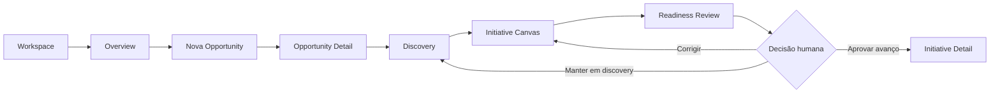

# UX e Jornada - Fluxium AI Product Management MVP

**Versão:** 0.1  
**Data:** 2026-09-18  
**Status:** Proposta para validação  
**PRD relacionado:** `AI_Product_Management_Platform_MVP_PRD_v0.1.md`

## 1. Objetivo da experiência

Permitir que um Product Manager saia de uma ideia pouco estruturada e chegue a
uma Initiative compreensível, com evidências, hipótese, lacunas e readiness
visíveis, sem perder o controle das decisões.

A experiência deve favorecer:

- entrada rápida;
- progressão guiada;
- edição manual a qualquer momento;
- contexto sempre visível;
- sugestões explicáveis;
- aprovação humana explícita;
- histórico recuperável.

## 2. Jornada principal

### 2.1 Cenário principal

1. O usuário entra no Workspace e identifica o Product de trabalho.
2. No Overview, seleciona `Nova Opportunity`.
3. Registra em linguagem simples o que deseja melhorar.
4. Confirma o Product e inicia a Discovery.
5. Responde às perguntas da IA e revisa o contexto estruturado.
6. Confirma Problem, Evidence e Hypothesis.
7. Revisa a Initiative no Canvas.
8. Executa Product Readiness.
9. Analisa score, confiança, lacunas e propostas.
10. Aprova uma proposta ou corrige manualmente.
11. Avança a Initiative ou mantém o trabalho em Discovery.

## 3. Mapa de telas do MVP

| ID | Tela | Objetivo | Acesso |
|---|---|---|---|
| UX-01 | Workspace Overview | Orientar o trabalho atual e mostrar pendências | Menu principal |
| UX-02 | Products | Selecionar ou criar o Product | Overview / menu |
| UX-03 | New Opportunity | Registrar a intenção inicial | CTA principal |
| UX-04 | Opportunity Detail | Acompanhar contexto e iniciar Discovery | Lista / Overview |
| UX-05 | AI Discovery | Estruturar problema, evidência e hipótese | Opportunity Detail |
| UX-06 | Initiative Canvas | Revisar e editar o contexto da Initiative | Discovery |
| UX-07 | Readiness Review | Avaliar preparação e decidir próximo passo | Initiative Canvas |
| UX-08 | Initiative Detail | Consultar Initiative, histórico e status | Readiness / lista |

Settings, administração de membros e autenticação podem existir como shell da
aplicação, mas não fazem parte da jornada central deste documento.

## 4. Navegação global

### 4.1 Menu principal

Itens do MVP:

- Overview;
- Products;
- Opportunities;
- Initiatives.

Discovery e Readiness devem ser acessados dentro do contexto da Opportunity ou
Initiative, evitando que o usuário perca a entidade em edição.

### 4.2 Contexto persistente

A interface deve exibir de forma consistente:

- Workspace atual;
- Product atual quando aplicável;
- OKR relacionado quando existir;
- status da entidade;
- última atualização;
- usuário responsável;
- ação de voltar sem perder alterações salvas.

O Workspace Switcher deve impedir a troca silenciosa durante uma edição com
alterações não salvas.

## 5. Definição das telas

### UX-01 - Workspace Overview

**Objetivo:** mostrar o estado do trabalho e indicar a próxima ação útil.

**Conteúdo:**

- seletor de Workspace;
- Product selecionado ou convite para criar um Product;
- CTA `Nova Opportunity`;
- lista resumida de Opportunities recentes;
- lista de Initiatives em Discovery;
- readiness pendente ou desatualizado;
- atividade recente relevante.

**Ações:**

- criar Opportunity;
- abrir Opportunity;
- abrir Initiative;
- trocar Product ou Workspace;
- continuar Discovery pendente.

**Estado vazio:** explicar o próximo passo com uma única ação primária:
`Criar Product` ou `Registrar Opportunity`.

**Regra:** o Overview não deve tentar substituir um dashboard analítico. No
MVP, ele deve orientar a jornada.

### UX-02 - Products

**Objetivo:** criar e selecionar o contexto de produto.

**Conteúdo:**

- nome;
- descrição;
- visão;
- status;
- quantidade de Opportunities e Initiatives;
- última atualização.

**Ações:**

- `Novo Product`;
- editar Product;
- abrir Opportunities;
- abrir Initiatives.

**Validações:** nome obrigatório; mensagens devem aparecer junto ao campo e
ser anunciadas para tecnologias assistivas.

### UX-03 - New Opportunity

**Objetivo:** reduzir o atrito para registrar uma intenção.

**Estrutura:**

- título curto;
- campo principal com a pergunta: `O que você está tentando melhorar?`;
- seletor de Product;
- origem opcional;
- ação `Salvar e iniciar Discovery`;
- ação secundária `Salvar como rascunho`.

**Comportamento:**

- salvar rascunho não inicia IA;
- `Salvar e iniciar Discovery` cria a Opportunity e abre UX-05;
- o usuário pode cancelar sem criar dados;
- texto informado nunca deve ser substituído automaticamente pela IA.

**Estado de erro:** se o salvamento falhar, manter o texto no formulário e
permitir tentar novamente.

### UX-04 - Opportunity Detail

**Objetivo:** apresentar o contexto da Opportunity e o progresso da Discovery.

**Conteúdo:**

- título, descrição, Product e status;
- autor e timestamps;
- resumo de Problem, Evidence e Hypothesis existentes;
- progresso da Discovery;
- perguntas abertas;
- histórico resumido;
- CTA `Continuar Discovery`;
- CTA `Criar Initiative` quando houver contexto mínimo.

**Ações:**

- editar dados manuais;
- iniciar ou continuar Discovery;
- rejeitar Opportunity com motivo;
- converter para Initiative;
- atualizar status conforme permissão.

**Regra:** a conversão não remove a Opportunity e deve manter o vínculo com a
Initiative criada.

### UX-05 - AI Discovery

**Objetivo:** conduzir descoberta sem transformar a tela em um chat isolado.

**Layout recomendado:**

- área principal: conversa e resposta do usuário;
- painel lateral: Problem, Audience, Evidence, Hypothesis, Outcome/KPI e Open Questions;
- barra superior: Opportunity, Product e status da sessão;
- rodapé: campo de resposta e ação de envio.

**Ações:**

- responder pergunta;
- editar informação estruturada;
- adicionar Evidence manual;
- adicionar Problem ou Hypothesis;
- aceitar sugestão individual;
- rejeitar sugestão;
- salvar e sair;
- finalizar Discovery.

**Comportamento de IA:**

- perguntas devem indicar por que a informação é necessária quando isso for útil;
- sugestões devem ser visualmente distintas de fatos confirmados;
- cada sugestão deve mostrar confiança e referências;
- informação ausente deve aparecer como pergunta aberta;
- a sessão deve funcionar em modo manual se a IA estiver indisponível.

**Não fazer:** preencher silenciosamente o painel lateral com conteúdo não
confirmado.

### UX-06 - Initiative Canvas

**Objetivo:** transformar o resultado da Discovery em uma Initiative revisável.

**Seções:**

1. Contexto: Opportunity, Problem e Audience.
2. Objetivo e resultado esperado.
3. Hypothesis.
4. Evidence.
5. KPI ou forma de medição.
6. Scope.
7. Out of Scope.
8. Dependencies e Risks informados.
9. OKR relacionado.
10. Plano 5W2H / Business Plan.
11. Status e versão.

O bloco de OKR deve permitir mais de um Objective e vários Key Results por
Objective. O bloco 5W2H deve ser explicitamente opcional e conter What, Why,
Where, When, Who, How e How Much quando utilizado.

**Ações:**

- editar campos;
- adicionar ou remover referências;
- salvar rascunho;
- solicitar Product Readiness;
- abrir histórico;
- voltar para Discovery.
- consultar o Business Plan estruturado;
- editar os campos 5W2H.

**Indicadores:**

- campos obrigatórios preenchidos;
- campos com informação ausente;
- alterações não salvas;
- versão atual.

**Regra:** o Canvas deve deixar claro o que foi escrito pelo usuário, o que
veio de uma fonte e o que é sugestão da IA.

O Business Plan deve ser uma visão estruturada da Initiative, com racional, OKR
relacionado, 5W2H, riscos e métricas. Não deve conter quadro de tarefas,
cronograma de execução ou orçamento detalhado neste estágio.

### UX-07 - Readiness Review

**Objetivo:** explicar se a Initiative está suficientemente preparada para
avançar.

**Conteúdo:**

- guia de construção de contexto em oito dimensões, com perguntas orientadoras
    e campos opcionais para fatos, evidências e restrições;
- score geral;
- confiança da avaliação;
- score por dimensão;
- justificativa de cada dimensão;
- evidências utilizadas;
- informações ausentes;
- perguntas abertas;
- propostas de alteração;
- versão do contexto avaliado;
- provider/modelo/prompt em área de detalhes auditáveis.

**Ações:**

- preencher o contexto guiado ou complementar a nota livre;
- `Resolver com IA` para uma lacuna específica;
- revisar proposta;
- aplicar proposta;
- rejeitar proposta;
- editar Canvas;
- executar nova avaliação;
- avançar status, se critérios e permissão permitirem.

**Regra:** `Aplicar proposta` sempre exige confirmação humana e deve indicar
exatamente os campos que serão alterados.

Somente usuários `ADMIN` ou `PRODUCT_MANAGER` podem aplicar propostas. Outros
perfis não podem executar essa ação nem alterar dados por esse fluxo.

**Estados:**

- não avaliada;
- avaliando;
- avaliação concluída;
- avaliação desatualizada;
- provider indisponível;
- avaliação com erro recuperável.

### UX-08 - Initiative Detail

**Objetivo:** servir como página de consulta após a revisão.

**Conteúdo:**

- status atual;
- objetivo;
- Problem, Evidence e Hypothesis;
- Scope e Out of Scope;
- score de Readiness e confiança;
- última avaliação;
- histórico de versões;
- decisões humanas;
- pendências.

**Ações:**

- editar conforme permissão;
- voltar ao Canvas;
- abrir avaliação;
- consultar histórico;
- alterar status permitido.

No MVP, não exibir Delivery, Release ou Outcome como se já existissem.

## 6. Jornada por estado

| Estado | Tela principal | Próxima ação | Critério de saída |
|---|---|---|---|
| Product inexistente | Products | Criar Product | Product salvo |
| Opportunity nova | New Opportunity | Salvar e iniciar Discovery | Opportunity `DISCOVERY` |
| Discovery incompleta | AI Discovery | Responder ou editar contexto | Contexto mínimo confirmado |
| Initiative em rascunho | Initiative Canvas | Completar campos | Dados mínimos preenchidos |
| Readiness pendente | Readiness Review | Executar avaliação | Assessment persistido |
| Lacunas encontradas | Readiness Review | Corrigir ou aceitar proposta | Lacunas resolvidas ou aceitas |
| Pronta para decisão | Initiative Detail | Avançar status | Transição autorizada |

## 7. Estados transversais obrigatórios

Toda tela que buscar ou salvar dados deve tratar:

- loading inicial;
- loading de ação;
- estado vazio;
- erro recuperável;
- erro de autorização;
- sessão expirada;
- alterações não salvas;
- conteúdo desatualizado por outra edição;
- indisponibilidade de IA;
- sucesso com confirmação observável.

A interface não deve bloquear toda a tela durante uma sugestão da IA se o
usuário ainda puder editar dados manuais.

## 8. Regras de aprovação e confiança

- sugestões da IA devem ter ação explícita de aceitar ou rejeitar;
- alterações aplicadas devem mostrar resumo antes da confirmação;
- score e confiança devem ser exibidos separadamente;
- baixa confiança deve resultar em perguntas ou aviso, não em falsa precisão;
- assessments antigos devem ser identificados como históricos;
- nenhuma ação externa existe no MVP.

## 9. Responsividade e acessibilidade

- A jornada deve funcionar em desktop e mobile.
- O painel lateral da Discovery deve tornar-se seção recolhível em telas estreitas.
- O Canvas deve preservar ordem lógica e permitir leitura linear.
- Todas as ações devem ser acessíveis por teclado.
- Campos devem possuir labels persistentes.
- Mensagens de erro devem estar associadas aos campos.
- Score não pode ser comunicado somente por cor.
- Contraste, foco visível e ordem de tabulação devem ser validados.

## 10. Critérios de aceite UX

### UX-AC-001 - Jornada principal

Um Product Manager deve conseguir criar Product, Opportunity, Discovery e
Initiative sem sair do contexto do Workspace.

### UX-AC-002 - Contexto visível

Em Opportunity, Discovery, Canvas e Readiness, o usuário deve saber qual
Workspace, Product e entidade está editando.

### UX-AC-003 - Distinção entre fato e sugestão

A interface deve diferenciar informação confirmada, informação ausente e
sugestão da IA.

### UX-AC-004 - Aprovação explícita

Nenhuma proposta da IA pode alterar dados sem uma ação de confirmação do
usuário autorizado.

### UX-AC-005 - Continuidade manual

Quando a IA estiver indisponível, o usuário deve conseguir salvar e editar os
dados manualmente.

### UX-AC-006 - Erros e recuperação

Falha de salvamento, timeout ou erro de provider deve preservar o trabalho local
quando possível e apresentar uma ação de recuperação.

### UX-AC-007 - Acessibilidade

Os fluxos críticos devem ser operáveis por teclado, possuir labels e expor
mensagens de erro e sucesso de forma acessível.

### UX-AC-008 - Histórico

A tela de Initiative deve permitir identificar versão atual, avaliações e
decisões humanas anteriores.

### UX-AC-009 - Estrutura de OKR

O usuário deve conseguir cadastrar mais de um Objective e cadastrar um ou mais
Key Results para cada Objective, distinguindo texto qualitativo de métricas
quantitativas com prazo.

### UX-AC-010 - 5W2H opcional

O usuário deve conseguir salvar uma Initiative sem preencher 5W2H e, quando
utilizar o bloco, visualizar What, Why, Where, When, Who, How e How Much.

### UX-AC-011 - Permissão de aprovação

Somente `ADMIN` e `PRODUCT_MANAGER` devem conseguir aplicar uma proposta da IA;
qualquer outro perfil deve ser bloqueado sem alterar dados.

## 11. Fora do escopo visual do MVP

- Product Graph interativo;
- roadmap visual;
- quadros Kanban de delivery;
- tela Jira;
- dashboards de outcomes;
- editor de experimentos;
- colaboração em tempo real;
- personalização avançada de layout;
- chat global sem contexto.

## 12. Questões de validação

1. O usuário inicia a jornada pelo Product ou diretamente pela Opportunity?
2. `Opportunity Detail` e `Initiative Detail` devem ser telas separadas no primeiro release?
3. Quais campos são obrigatórios para permitir a criação da Initiative?
4. Qual score mínimo e quais dimensões bloqueiam o avanço?
5. Contributors podem aplicar sugestões da IA ou somente Product Managers?
6. A sessão de Discovery deve permitir anexos no MVP?
7. Qual provider e tempo esperado de resposta devem ser exibidos ao usuário?
8. O histórico deve permitir comparar versões lado a lado?
9. O MVP precisa suportar múltiplos Products no mesmo Workspace desde o primeiro release?
10. Qual evento define que a Discovery foi concluída?
