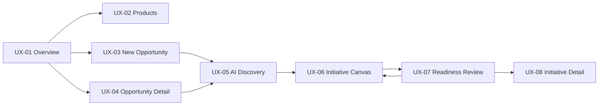

# Wireframes - Fluxium AI Product Management MVP

**Versao:** 0.1  
**Data:** 2026-09-18  
**Status:** Proposta para validacao  
**Base:** `AI_Product_Management_Platform_MVP_UX_v0.1.md`  
**PRD relacionado:** `AI_Product_Management_Platform_MVP_PRD_v0.1.md`

## 1. Objetivo

Estes wireframes sao low-fidelity e servem para validar a hierarquia, a navegacao e os principais estados da jornada antes do design visual e da implementacao frontend.

O wireframe preserva tres distincoes fundamentais:

- **Confirmado:** informacao registrada ou aprovada pelo usuario;
- **Fonte:** informacao acompanhada de referencia;
- **Sugestao:** proposta da IA que exige revisao humana.

Os blocos abaixo representam a estrutura relativa da tela, nao dimensoes finais nem componentes visuais definitivos.

## 2. Convencoes

```text
[CTA]       acao primaria ou secundaria
(icone)     acao compacta
{campo}     campo editavel
<status>    estado ou etiqueta
[IA]        sugestao gerada pela IA
[FONTE]     referencia ou evidencia vinculada
!           lacuna, alerta ou erro recuperavel
```

## 3. Navegacao e shell global

```text
+--------------------------------------------------------------------------------+
| FLUXIUM | [Workspace v] | [Product v] | [OKR v]       [Busca] [Perfil] |
+----------------------+---------------------------------------------------------+
| OVERVIEW             |                                                         |
| PRODUCTS             |              area da tela atual                        |
| OPPORTUNITIES        |                                                         |
| INITIATIVES          |                                                         |
|                      |                                                         |
| + Nova Opportunity   |                                                         |
+----------------------+---------------------------------------------------------+
```

Regras do shell:

- manter Workspace e Product visiveis quando houver contexto;
- indicar entidade, status e ultima atualizacao na area superior;
- bloquear troca de Workspace/Product silenciosa se houver alteracoes nao salvas;
- em mobile, converter o menu lateral em menu recolhivel e manter o contexto no topo.

## 4. Mapa de navegacao



## 5. UX-01 - Workspace Overview

**Objetivo:** orientar o trabalho atual e apresentar uma proxima acao util.

### Desktop

```text
+--------------------------------------------------------------------------------+
| Workspace: Acme [v] | Product: Payments [v]                    [Perfil]       |
+----------------------+---------------------------------------------------------+
| OVERVIEW             | Payments                                      [Editar]    |
| PRODUCTS             | Product ativo | atualizado ha 2h                       |
| OPPORTUNITIES        |                                                         |
| INITIATIVES          | +----------------------+  +----------------------+  |
|                      | | PROXIMA ACAO         |  | CONTEXTO             |  |
| + Nova Opportunity   | | [Continuar Discovery]|  | 3 Opportunities      |  |
|                      | | ou [Nova Opportunity]|  | 1 Initiative         |  |
|                      | +----------------------+  +----------------------+  |
|                      |                                                         |
|                      | Opportunities recentes            [Ver todas]          |
|                      | +----------------------------------------------------+ |
|                      | | Titulo              Status       Atualizado  Acao  | |
|                      | | Reduzir abandono    DISCOVERY    hoje       Abrir | |
|                      | | Melhorar ativacao   RASCUNHO     ontem      Abrir | |
|                      | +----------------------------------------------------+ |
|                      |                                                         |
|                      | Initiatives em Discovery       Readiness pendente       |
|                      | [Initiative A - Continuar]     [Initiative B - Revisar]  |
|                      |                                                         |
|                      | Atividade recente                                      |
|                      | [Historico resumido de edicoes e decisoes]             |
+----------------------+---------------------------------------------------------+
```

### Estado vazio

```text
+-----------------------------------------------+
| Ainda nao existe um Product                   |
| Crie o contexto antes de registrar trabalho.  |
|                  [Criar Product]              |
+-----------------------------------------------+
```

Se ja houver Product, mas nenhuma Opportunity: substituir a mensagem por
`Comece registrando uma oportunidade` e o CTA `Nova Opportunity`.

### Mobile

```text
+--------------------------------+
| [Menu] Payments [v] [Perfil]   |
| Overview                       |
|                                |
| PROXIMA ACAO                  |
| [Continuar Discovery]          |
|                                |
| Opportunities recentes         |
| [Opportunity] <status> [Abrir] |
| [Opportunity] <status> [Abrir] |
|                                |
| [Nova Opportunity]             |
+--------------------------------+
```

**Rastreabilidade:** UX-01, UX-02, UX-03; REQ-MVP-001, REQ-MVP-002.

## 6. UX-02 - Products

**Objetivo:** selecionar ou criar o contexto de produto.

### Lista desktop

```text
+--------------------------------------------------------------------------------+
| Products                                                   [Novo Product]      |
+----------------------+---------------------------------------------------------+
| OVERVIEW             | Products                                                  |
| PRODUCTS             | [Buscar por nome...] [Status v]                          |
| OPPORTUNITIES        |                                                         |
| INITIATIVES          | +-----------------------------------------------------+ |
|                      | | Nome       Status    Opps  Initiatives  Atualizado | |
|                      | | Payments   ACTIVE       4          2      hoje      | |
|                      | | Onboarding ACTIVE       2          1      ontem     | |
|                      | +-----------------------------------------------------+ |
|                      |                                                         |
|                      | Selecione um Product para ver Opportunities e Initiatives|
+----------------------+---------------------------------------------------------+
```

### Novo/editar Product

```text
+----------------------------------------------------------+
| < Products                         Novo Product          |
+----------------------------------------------------------+
| Nome *                                                    |
| { Payments____________________________________________ } |
| Descricao                                                 |
| { _________________________________________________      } |
| Visao                                                     |
| { _________________________________________________      } |
| Status               [ACTIVE v]                           |
|                                                          |
| [Cancelar]                              [Salvar Product] |
+----------------------------------------------------------+
! Nome e obrigatorio.
```

O erro aparece junto ao campo, com mensagem acessivel para leitor de tela.

**Rastreabilidade:** UX-02; REQ-MVP-001.

## 7. UX-03 - New Opportunity

**Objetivo:** registrar uma intencao com baixo atrito, sem substituir o texto original.

```text
+--------------------------------------------------------------------------------+
| < Overview / Payments                         Nova Opportunity                |
+--------------------------------------------------------------------------------+
| Nova Opportunity                                                              |
| Registre o que voce deseja investigar.                                        |
|                                                                                |
| Titulo curto *                                                                |
| { Reduzir abandono no checkout_______________________________ }               |
|                                                                                |
| O que voce esta tentando melhorar? *                                          |
| +--------------------------------------------------------------------------+  |
| | Muitos usuarios abandonam antes de concluir o pagamento.                 |  |
| |                                                                          |  |
| +--------------------------------------------------------------------------+  |
| Product *              [Payments v]                                          |
| Origem (opcional)      { Entrevista, suporte, dado...________________ }       |
|                                                                                |
| ! O texto sera preservado. A IA podera sugerir estrutura depois.              |
|                                                                                |
| [Cancelar]              [Salvar como rascunho]      [Salvar e iniciar Discovery]
+--------------------------------------------------------------------------------+
```

### Erro de salvamento

```text
! Nao foi possivel salvar a Opportunity. Seus dados foram preservados.
                         [Tentar novamente]
```

**Rastreabilidade:** UX-03; REQ-MVP-002, REQ-MVP-003.

## 8. UX-04 - Opportunity Detail

**Objetivo:** acompanhar contexto e progresso da Discovery.

```text
+--------------------------------------------------------------------------------+
| < Opportunities | Payments       Opportunity: Reduzir abandono       <DISCOVERY>|
| Autor: Ana | Atualizada hoje | Versao 3                         [Editar]       |
+--------------------------------------------------------------------------------+
| +----------------------------------+  +---------------------------------------+ |
| | CONTEXTO                         |  | DISCOVERY                             | |
| | Problem                          |  | Progresso             3 de 6        | |
| | [Confirmado ou Ainda vazio]      |  | [====------]                          | |
| |                                  |  |                                       | |
| | Evidence                         |  | Perguntas abertas                    | |
| | [2 fontes] [Ver referencias]     |  | • Qual segmento e mais afetado?     | |
| |                                  |  | • Como medir abandono?              | |
| | Hypothesis                       |  |                                       | |
| | [Sugestao pendente]              |  | [Continuar Discovery]                | |
| +----------------------------------+  +---------------------------------------+ |
|                                                                                |
| Descricao original                                                            |
| [Texto informado pelo usuario, preservado]                                    |
|                                                                                |
| Historico resumido                                                             |
| [Criada] [Discovery iniciada] [Evidence adicionada] [Ver historico]           |
|                                                                                |
| [Rejeitar Opportunity]                         [Criar Initiative]             |
+--------------------------------------------------------------------------------+
```

`Criar Initiative` fica desabilitado ou acompanhado de uma explicacao quando o
contexto minimo ainda nao estiver confirmado.

**Rastreabilidade:** UX-04; REQ-MVP-003, REQ-MVP-004, REQ-MVP-008.

## 9. UX-05 - AI Discovery

**Objetivo:** conduzir a descoberta com conversa e contexto estruturado lado a lado.

### Desktop

```text
+--------------------------------------------------------------------------------+
| < Opportunity: Reduzir abandono | Product: Payments | Discovery <IN PROGRESS>  |
| [Salvar e sair]                                                        [Ajuda] |
+-----------------------------------------------+--------------------------------+
| DISCOVERY                                     | CONTEXTO ESTRUTURADO           |
|                                               |                                |
| IA: Para quem o problema ocorre?              | Problem                         |
| Motivo: definir o publico afetado.            | [CONFIRMADO]                    |
|                                               | Usuarios abandonam checkout    |
| Voce: Principalmente novos clientes...        |                                |
|                                               | Audience                       |
| IA: Ha evidencia observavel?                  | [SUGESTAO] 82%                 |
|                                               | Novos clientes                 |
|                                               | [Aceitar] [Editar] [Rejeitar]  |
|                                               |                                |
|                                               | Evidence                       |
|                                               | [FONTE] Pesquisa suporte #42   |
|                                               | [+ Adicionar evidence]         |
|                                               |                                |
|                                               | Hypothesis                     |
|                                               | [LACUNA] Ainda nao confirmado  |
|                                               |                                |
|                                               | Outcome / KPI                  |
|                                               | [LACUNA]                      |
|                                               |                                |
|                                               | Open Questions                 |
|                                               | [2 perguntas]                  |
+-----------------------------------------------+--------------------------------+
| {Digite sua resposta...}                                  [Enviar] [Finalizar] |
+--------------------------------------------------------------------------------+
```

### IA indisponivel / modo manual

```text
! A IA esta indisponivel no momento. Voce pode continuar manualmente.
[Adicionar Problem] [Adicionar Evidence] [Adicionar Hypothesis]

O painel estruturado continua editavel; nenhuma informacao e preenchida
silenciosamente.
```

Cada sugestao deve expor confianca, referencia quando houver e acao individual
de aceitar, editar ou rejeitar.

### Mobile

```text
+--------------------------------+
| [<] Discovery       [Salvar]   |
| Reduzir abandono <IN PROGRESS> |
+--------------------------------+
| CONTEXTO [Abrir painel]        |
|                                |
| IA: Para quem o problema ocorre?|
|                                |
| Voce: Novos clientes...        |
|                                |
| {Sua resposta...} [Enviar]     |
|                                |
| [Finalizar Discovery]          |
+--------------------------------+
```

O painel estruturado abre como drawer ou tela secundaria, preservando o retorno
para a conversa.

**Rastreabilidade:** UX-05; REQ-MVP-004, REQ-MVP-005, REQ-MVP-006, REQ-MVP-009.

## 10. UX-06 - Initiative Canvas

**Objetivo:** revisar e editar a Initiative antes da avaliacao.

```text
+--------------------------------------------------------------------------------+
| < Discovery | Payments       Initiative Canvas             [Historico] [v3]    |
| Status: DRAFT                                  [Salvar] [Solicitar Readiness] |
+--------------------------------------------------------------------------------+
| COMPLETUDE: 7/9 campos obrigatorios       ! 2 lacunas       * Nao salvo       |
+--------------------------------------------------------------------------------+
| OKRs:                                                                  [+ OKR] |
| Objective: Melhorar conversao | KRs: [Aumentar conclusao] [Reduzir abandono]   |
| BUSINESS PLAN: 5W2H opcional                 [Abrir visao estruturada]          |
+--------------------------------------------------------------------------------+
| 1. CONTEXTO                                                                    |
| Opportunity     [Reduzir abandono no checkout]                                |
| Problem         [CONFIRMADO] Usuarios abandonam antes do pagamento             |
| Audience        [SUGESTAO - revisar] Novos clientes                           |
|                                                                                |
| 2. OBJETIVO E RESULTADO ESPERADO                                               |
| { Aumentar conclusao do checkout _________________________________ }           |
|                                                                                |
| 3. HYPOTHESIS                                                                  |
| { Se simplificarmos ..., entao ... ______________________________ }           |
|                                                                                |
| 4. EVIDENCE                                           [+ Adicionar referencia] |
| [FONTE] Pesquisa #42        [FONTE] Evento checkout_abandon                    |
|                                                                                |
| 5. KPI / MEDICAO                                                               |
| { Taxa de conclusao do checkout _________________________________ }            |
|                                                                                |
| 6. SCOPE                                                                      |
| { _________________________________________________________________ }          |
| 7. OUT OF SCOPE                                                                |
| { _________________________________________________________________ }          |
| 8. DEPENDENCIES E RISKS                                                        |
| { _________________________________________________________________ }          |
|                                                                                |
| 9. PLANO 5W2H / BUSINESS PLAN (OPCIONAL)                                      |
| What { Iniciativa para reduzir abandono ____________________________ }         |
| Why  { Melhorar conversao e experiencia ____________________________ }         |
| Who  { Product Manager / time responsavel __________________________ }         |
| When { Periodo ou marco ____________________________________________ }         |
| Where{ Jornada ou canal afetado ____________________________________ }         |
| How  { Abordagem inicial ___________________________________________ }         |
| How Much { Estimativa ou impacto esperado _________________________ }         |
|                                                                                |
| [Voltar para Discovery]       [Salvar rascunho]       [Solicitar Readiness]    |
+--------------------------------------------------------------------------------+
```

Indicadores de origem devem aparecer no campo ou junto ao valor, sem depender
apenas de cor. `Solicitar Readiness` explica campos ausentes antes de executar.

**Rastreabilidade:** UX-06; REQ-MVP-006, REQ-MVP-007, REQ-MVP-008, REQ-MVP-010.

## 11. UX-07 - Readiness Review

**Objetivo:** explicar a avaliacao e apoiar uma decisao humana.

### Avaliacao concluida

```text
+--------------------------------------------------------------------------------+
| < Initiative Canvas | Readiness Review             Avaliada na versao 3 [v3]   |
+--------------------------------------------------------------------------------+
| READINESS GERAL                                                                |
|                 72 / 100                 Confianca: MEDIA                      |
|              [============------]         [Ver detalhes de auditoria]          |
|                                                                                |
| DIMENSOES                                                                      |
| +----------------------+--------+--------------------------------------------+ |
| | Problema             | 85     | Claro, mas falta segmento prioritario    | |
| | Evidencia            | 70     | 2 fontes, uma precisa de validacao      | |
| | Hipotese             | 60     | Relacao causal ainda nao confirmada     | |
| | Medicao              | 75     | KPI definido, baseline ausente          | |
| +----------------------+--------+--------------------------------------------+ |
|                                                                                |
| LACUNAS E PERGUNTAS                                                           |
| ! Definir segmento prioritario                         [Resolver com IA]       |
| ! Informar baseline do KPI                              [Editar Canvas]        |
|                                                                                |
| PROPOSTAS DA IA                                                                |
| +--------------------------------------------------------------------------+  |
| | P1. Audience = "Novos clientes do checkout" | Confianca 82%              |  |
| | Campos afetados: Audience                                                 |  |
| | [Revisar proposta] [Aplicar proposta] [Rejeitar]                          |  |
| +--------------------------------------------------------------------------+  |
|                                                                                |
| [Editar Canvas] [Executar nova avaliacao]                 [Avancar status]     |
+--------------------------------------------------------------------------------+
```

### Modal de confirmacao de proposta

```text
+--------------------------------------------------------------+
| Aplicar proposta P1?                                        |
|                                                              |
| Campo alterado: Audience                                    |
| Atual: Ainda nao confirmado                                 |
| Novo:  Novos clientes do checkout                           |
| Origem: sugestao IA | Confianca: 82%                        |
|                                                              |
| Esta acao sera registrada no historico.                     |
| [Cancelar]                              [Confirmar aplicacao]|
+--------------------------------------------------------------+
```

Para `CONTRIBUTOR` e `VIEWER`, a acao de aplicacao deve aparecer bloqueada ou
ser substituida por uma mensagem de permissao. Somente `ADMIN` e
`PRODUCT_MANAGER` podem confirmar a aplicacao.

### Estados

```text
Nao avaliada:           [Executar avaliacao]
Avaliando:              [Spinner] Analisando versao 3...
Desatualizada:          ! O Canvas mudou desde a avaliacao. [Avaliar novamente]
Provider indisponivel:  ! Nao foi possivel avaliar. [Tentar novamente] [Editar]
Erro recuperavel:       ! Falha ao persistir resultado. [Tentar novamente]
```

Detalhes auditaveis devem informar provider, modelo, prompt/versionamento,
versao avaliada e timestamp sem dominar a leitura principal.

**Rastreabilidade:** UX-07; REQ-MVP-007, REQ-MVP-008, REQ-MVP-009, REQ-MVP-010.

## 12. UX-08 - Initiative Detail

**Objetivo:** consultar a Initiative depois da revisao, com historico e pendencias.

```text
+--------------------------------------------------------------------------------+
| < Initiatives | Payments       Initiative: Reduzir abandono       <READY>       |
| Ultima atualizacao: hoje | Versao 4                         [Editar Canvas]    |
+--------------------------------------------------------------------------------+
| +--------------------------------------+  +-----------------------------------+ |
| | OBJETIVO                             |  | READINESS                         | |
| | Aumentar conclusao do checkout      |  | 72/100 | Confianca media            | |
| |                                      |  | [Abrir avaliacao]                 | |
| | Problem                              |  |                                   | |
| | Usuarios abandonam antes pagamento  |  | PENDENCIAS                        | |
| |                                      |  | • Validar baseline do KPI        | |
| | Hypothesis                           |  | • Revisar evidencia #42          | |
| | Se simplificarmos ..., entao ...    |  |                                   | |
| +--------------------------------------+  +-----------------------------------+ |
|                                                                                |
| Evidence                                                                      |
| [FONTE] Pesquisa #42   [FONTE] Evento checkout_abandon   [Ver todas]          |
|                                                                                |
| Scope                                  Out of Scope                            |
| [Resumo do escopo]                     [Itens explicitamente excluidos]       |
|                                                                                |
| Historico de versoes                   Decisoes humanas                        |
| [v1] [v2] [v3] [v4 atual]              [Proposta P1 aplicada por Ana]         |
|                                                                                |
| [Abrir Readiness]                         [Alterar status v]                   |
+--------------------------------------------------------------------------------+
```

Nao exibir Delivery, Release ou Outcome como se fossem modulos disponiveis no
MVP.

**Rastreabilidade:** UX-08; REQ-MVP-007, REQ-MVP-008, REQ-MVP-010.

## 13. Estados transversais

Os estados abaixo devem conservar o contexto e oferecer uma acao clara:

| Estado | Representacao no wireframe | Acao esperada |
|---|---|---|
| Loading inicial | skeleton da area principal, shell preservado | aguardar sem perder contexto |
| Loading de acao | CTA desabilitado com indicador | evitar duplo envio |
| Vazio | mensagem curta + uma acao primaria | criar Product ou Opportunity |
| Erro recuperavel | mensagem acionavel proxima ao conteudo | tentar novamente |
| Nao autorizado | estado sem dados sensiveis | voltar ou solicitar permissao |
| Sessao expirada | aviso persistente | autenticar novamente |
| Nao salvo | marcador `* Nao salvo` | salvar, sair ou descartar com confirmacao |
| Conteudo desatualizado | aviso de versao concorrente | recarregar e revisar conflito |
| IA indisponivel | banner + edicao manual | continuar manualmente |
| Sucesso | confirmacao observavel e timestamp | seguir para proxima acao |

## 14. Regras de interacao a validar

1. `Salvar como rascunho` nunca inicia IA.
2. `Salvar e iniciar Discovery` cria a Opportunity e abre a sessao de Discovery.
3. Sugestoes da IA nunca alteram campos confirmados sem aprovacao humana.
4. `Aplicar proposta` mostra diff dos campos e exige confirmacao explicita.
5. Uma avaliacao de Readiness sempre referencia a versao do Canvas avaliada.
6. Rejeitar uma Opportunity exige motivo e preserva o historico.
7. Converter Opportunity em Initiative preserva o vinculo e nao apaga a Opportunity.
8. Trocar Workspace/Product com alteracoes nao salvas exige decisao explicita.

## 15. Matriz de cobertura

| Tela | Criterios UX | Requisitos PRD relacionados |
|---|---|---|
| UX-01 Overview | UX-AC-001 | REQ-MVP-001, REQ-MVP-002 |
| UX-02 Products | UX-AC-002 | REQ-MVP-001 |
| UX-03 New Opportunity | UX-AC-003 | REQ-MVP-002, REQ-MVP-003 |
| UX-04 Opportunity Detail | UX-AC-004 | REQ-MVP-003, REQ-MVP-004, REQ-MVP-008 |
| UX-05 AI Discovery | UX-AC-005 | REQ-MVP-004, REQ-MVP-005, REQ-MVP-006, REQ-MVP-009 |
| UX-06 Initiative Canvas | UX-AC-006, UX-AC-009, UX-AC-010 | REQ-MVP-006, REQ-MVP-007, REQ-MVP-008, REQ-MVP-011, REQ-MVP-012 |
| UX-07 Readiness Review | UX-AC-007, UX-AC-011 | REQ-MVP-007, REQ-MVP-008, REQ-MVP-009, REQ-MVP-010 |
| UX-08 Initiative Detail | UX-AC-008 | REQ-MVP-007, REQ-MVP-008, REQ-MVP-010 |

## 16. Fora deste artefato

- identidade visual final, tipografia e tokens de design;
- especificacao pixel-perfect;
- componentes frontend implementados;
- prototipo navegavel de alta fidelidade;
- telas de autenticacao, Settings e administracao de membros;
- Delivery, Release, Outcome e Product Graph.

## 17. Perguntas para validacao com Product Owner

1. O Overview deve priorizar sempre uma Opportunity pendente ou uma Readiness pendente?
2. O Product pode ser criado durante o formulario de Opportunity ou somente em Products?
3. Qual e o conjunto minimo de campos que permite solicitar Readiness?
4. Quais transicoes de status ficam disponiveis para cada perfil no MVP?
5. O painel de auditoria deve ser expandido na Readiness Review ou aberto em uma tela secundaria?
